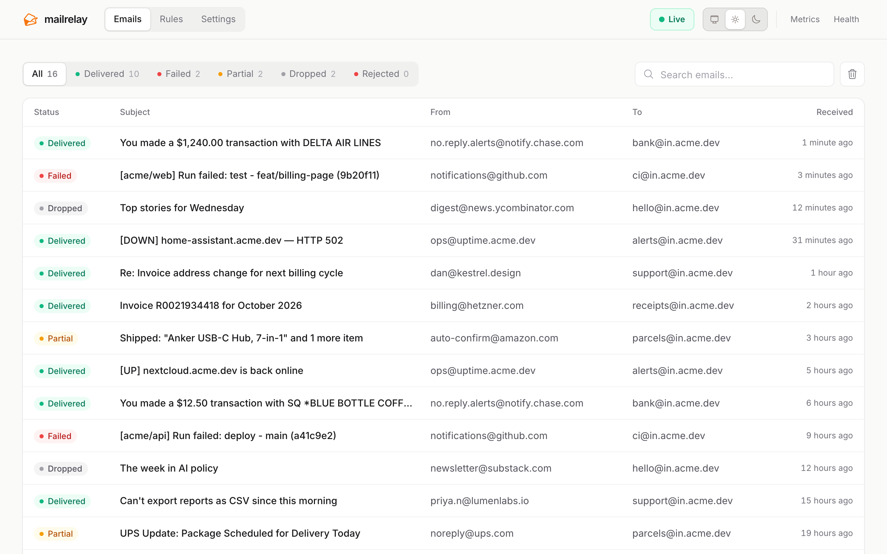
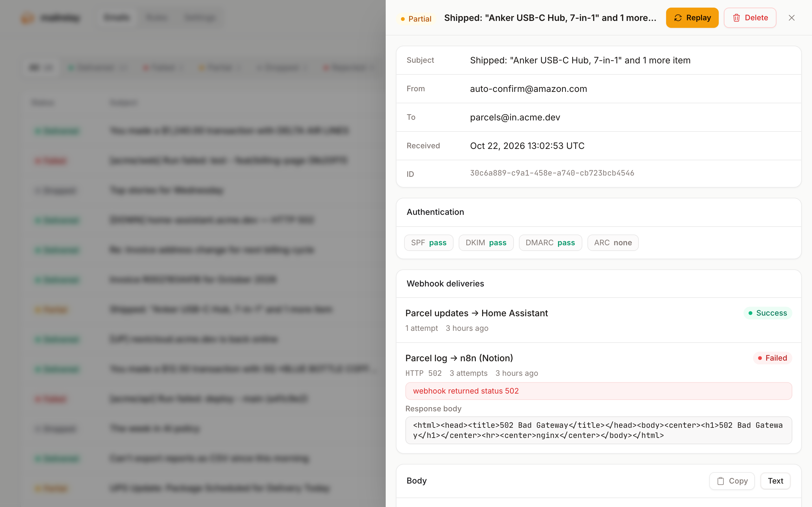
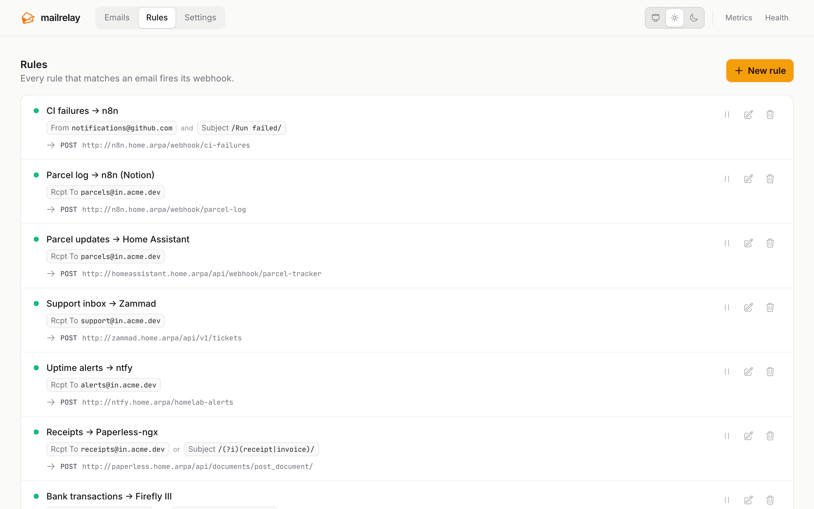

<p align="center">
  
</p>

<h1 align="center">mailrelay</h1>

<p align="center">Turn incoming email into webhooks. A small, self-hosted SMTP server that checks each email against your rules and sends the matches to your webhooks, with a web UI to see what arrived and how each webhook responded.</p>

<p align="center">
  <picture>
    <source media="(prefers-color-scheme: dark)" srcset="docs/screenshots/dashboard-dark.png">
    
  </picture>
</p>

Point an MX record (or a forwarding rule) at mailrelay and wire email into the things that only speak HTTP:

- **Bank and card alerts** → your budgeting app (Firefly III, Actual)
- **Receipts and invoices** → Paperless-ngx or your accounting tool
- **Monitoring alerts** → ntfy, Slack, Discord, PagerDuty
- **A support address** → your helpdesk (Zammad, Linear, a custom API)
- **Shipping notifications** → Home Assistant
- **Anything else** → n8n, Zapier-style automations, your own service

## Quick start

All you need is Docker. This starts mailrelay plus a small echo server that serves as a test webhook:

```bash
curl -fsSLO https://raw.githubusercontent.com/gowthamgts/mailrelay/main/docker-compose.quickstart.yaml
docker compose -f docker-compose.quickstart.yaml up -d
```

Send it an email (plain `curl` speaks SMTP):

```bash
curl smtp://localhost:2525 --mail-from me@example.com --mail-rcpt hello@example.com --upload-file - <<'EOF'
From: me@example.com
To: hello@example.com
Subject: Hello from mailrelay

It works!
EOF
```

Then:

1. Open **http://localhost:2623**. The email is there, marked *Dropped* because no rule matched yet.
2. Go to **Rules → New rule**, leave the conditions empty (matches everything) and set the webhook URL to `http://echo:8080/`.
3. Open the email and click **Replay**. It is now *Delivered*, and the response body shows exactly what your webhook received.

Clean up with `docker compose -f docker-compose.quickstart.yaml down -v`.

## Deploy

**Docker.** For a real server, start from [`docker-compose.example.yaml`](docker-compose.example.yaml), or:

```bash
docker run -d --name mailrelay \
  -p 25:25 -p 127.0.0.1:2623:2623 \
  -v mailrelay_data:/data \
  -e MAILRELAY_SMTP__DOMAIN=mx.example.com \
  ghcr.io/gowthamgts/mailrelay:latest
```

Add `-e MAILRELAY_WEBHOOK__ALLOW_PRIVATE_NETWORKS=true` if your webhooks point at services on your network. The image keeps everything under `/data` (SQLite database, raw `.eml` files, and an optional `config.yaml`) and enables the web UI.

**Binary.** Download a release from the [releases page](https://github.com/gowthamgts/mailrelay/releases), or build it with `go build ./cmd/mailrelay`. Then run `./mailrelay -config config.yaml`.

> [!IMPORTANT]
> The web UI has no login unless you configure `http.auth` (OIDC). Keep port 2623 on localhost, or put it behind a reverse proxy that handles auth. Also set `smtp.allowed_recipients` so only your addresses are accepted.

## How it works

```
SMTP ──▶ SPF / DKIM / DMARC ──▶ rule matching ──▶ webhooks (async, with retries)
               (off | log | enforce)          every matching rule fires
```

mailrelay replies `250 OK` as soon as it accepts an email. Webhooks are sent in the background with exponential backoff, so a slow or failing webhook never bounces mail. Every attempt is recorded, and any email can be replayed from the UI.

## Rules

Rules are created in the web UI and take effect immediately. Each rule has **conditions** and a **webhook**.

- **Fields**: From, To, CC, Subject, Body, any header, the SMTP envelope (`MAIL FROM` / `RCPT TO`), and the domain of each address.
- **Patterns**: globs by default (`alerts@*`, `*.example.com`); wrap a pattern in slashes for a regex (`/^\[URGENT\]/`, or `/(?i)invoice/` to ignore case).
- **Match all or any** of the conditions. A rule with no conditions matches every email.
- Every matching rule fires, not just the first one.
- Each webhook can override the timeout and retry settings, and the **Test** button checks that the URL is reachable.
- Webhooks can't reach private or internal addresses (localhost, your LAN, Docker networks, Tailscale, cloud metadata) unless you set `webhook.allow_private_networks: true`. Turn it on if your webhooks point at self-hosted services.

### Payload

With no template, the webhook receives the whole parsed email:

```json
{
  "from": "sender@example.com",
  "to": ["you@example.com"],
  "subject": "Hello",
  "text_body": "…",
  "html_body": "…",
  "attachments": [{ "filename": "a.pdf", "content_type": "application/pdf", "content": "base64…" }],
  "auth_result": { "spf": "pass", "dkim": "pass", "dmarc": "pass", "arc": "none" },
  "envelope_from": "bounce@example.com",
  "envelope_to": ["you@example.com"]
}
```

Or write a [Go template](https://pkg.go.dev/text/template). Every variable is already JSON-encoded, so don't put quotes around it:

```
{"text": {{ .Subject }}, "from": {{ .From }}, "body": {{ .TextBody | default .HTMLBody }}}
```

| Variables | Functions |
| --- | --- |
| `.From` `.To` `.CC` `.Subject` `.TextBody` `.HTMLBody` `.Headers` `.Attachments` `.AuthResult` `.EnvelopeFrom` `.EnvelopeTo` | `first`, `last`, `join ", "`, `default <fallback>`. Chain them: `{{ .CC \| default .To \| first }}` |

Missing fields render as `null`, so the output is always valid JSON. The editor in the UI autocompletes variables and flags mistakes as you type.

<p align="center">
  <picture>
    <source media="(prefers-color-scheme: dark)" srcset="docs/screenshots/email-detail-dark.png">
    
  </picture>
  <picture>
    <source media="(prefers-color-scheme: dark)" srcset="docs/screenshots/rules-dark.png">
    
  </picture>
</p>

## Configuration

Settings are layered: built-in defaults, then an optional config file (YAML, JSON or TOML), then `MAILRELAY_` environment variables, with `__` for nesting (`MAILRELAY_SMTP__DOMAIN`). Lists such as `smtp.allowed_recipients` and auth providers must go in the file. [`config.example.yaml`](config.example.yaml) documents every option.

| Setting | Default |
| --- | --- |
| `smtp.addr` | `0.0.0.0:25` |
| `smtp.allowed_recipients` | empty (accept any recipient) |
| `http.addr` | `127.0.0.1:2623` (`0.0.0.0:2623` in Docker) |
| `webui.enabled` | `false` (`true` in Docker) |
| `webui.retention_days` | `7` |
| `auth.spf` / `dkim` / `dmarc` | `log` (`off`, `log` or `enforce`; `enforce` rejects with SMTP 550) |
| `retry.max_retries` / `retry.timeout` | `3` / `30s` |
| `webhook.allow_private_networks` | `false` (blocks localhost, LAN, Docker, Tailscale and metadata addresses) |

Retry, auth mode, log level and retention can also be changed at runtime on the **Settings** page.

**Forwarded mail.** When a provider such as Gmail or Fastmail forwards to mailrelay, the envelope addresses differ from the headers. The UI shows the original header From/To and lists the envelope separately, and rules can match either one. ARC is verified so the original SPF/DKIM results survive forwarding.

## Operations

| Endpoint | |
| --- | --- |
| `/healthz` | Liveness probe, returns `ok` |
| `/metrics` | Prometheus metrics (`mailrelay_*`). See [docs/prometheus.md](docs/prometheus.md) and the [Grafana dashboard](docs/grafana-dashboard.json). |

`mailrelay -version` prints the build version.

## Development

```bash
just dev        # run with config.dev.yaml (SMTP on :2525, UI on :2623)
just dev-test   # send a batch of sample emails with swaks
just test
```

## License

[MIT](LICENSE.md)
